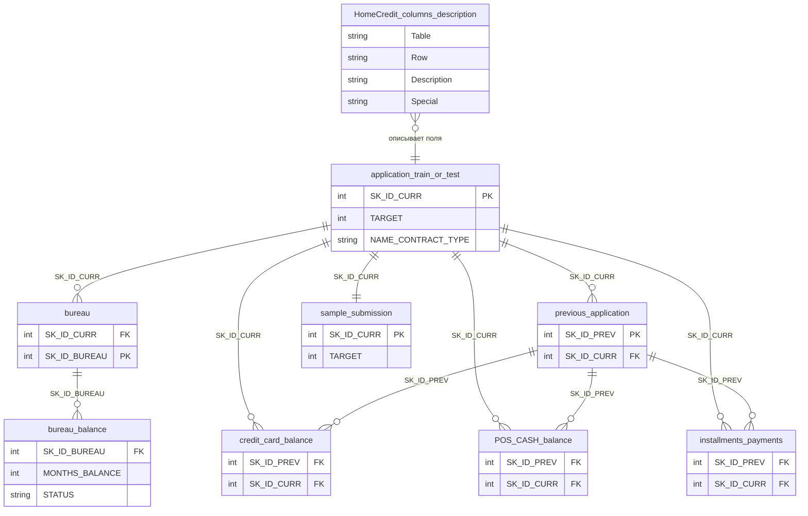

| Name                  | Table                                                                                                                                                       |
| --------------------- | ----------------------------------------------------------------------------------------------------------------------------------------------------------- |
| application_train     | one row per client with the full loan application profile (income, credit, demographics, external scores) and the binary `TARGET` label indicating default. |
| bureau                | one row per client's credit account at other banks (credit type, status, amounts, overdue, duration).                                                       |
| bureau_balance        | monthly status history of each bureau credit account, showing delinquency progression over time.                                                            |
| credit_card_balance   | monthly per-card balance, limit, spending, payment, and overdue (DPD) history for each client's credit cards.                                               |
| installments_payments | one row per scheduled installment with planned vs actual payment dates and amounts, revealing lateness and underpayment.                                    |
| POS_CASH_balance      | monthly snapshot of each POS/cash loan showing remaining installments, contract status, and days past due.                                                  |
| previous_application  | one row per client's prior loan application at Home Credit (amounts, status, decision, channel, product terms).                                             |
| sample_submission     | submission template with `SK_ID_CURR` from test and an empty `TARGET` column to fill with predicted default probabilities.                                  |